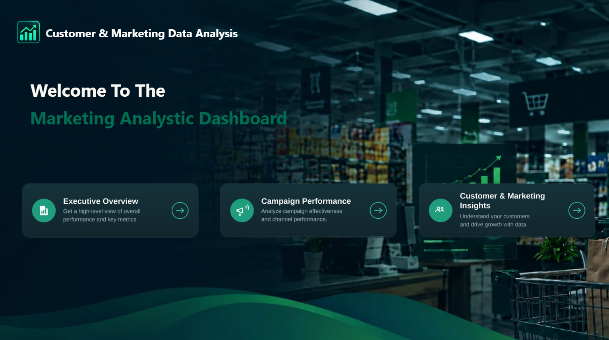
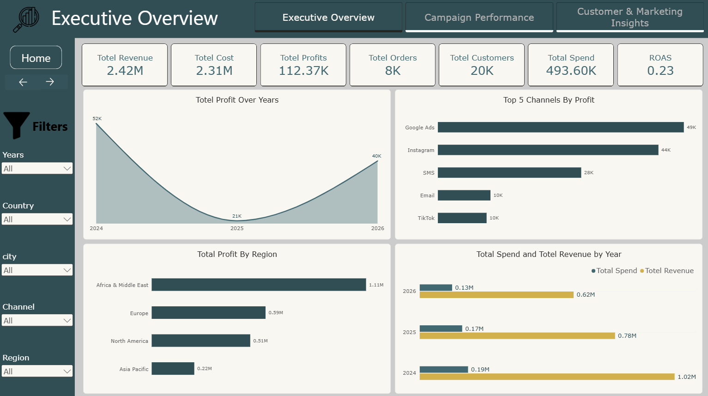
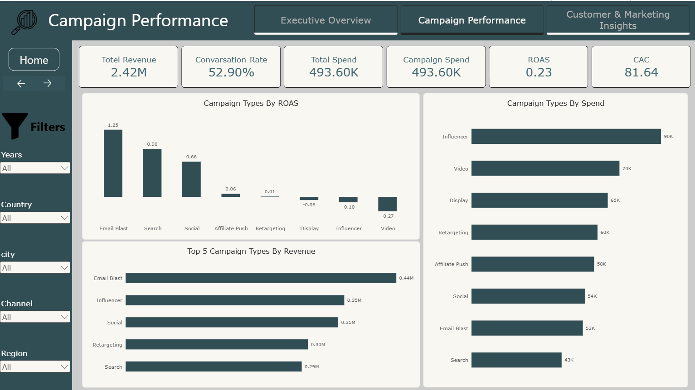
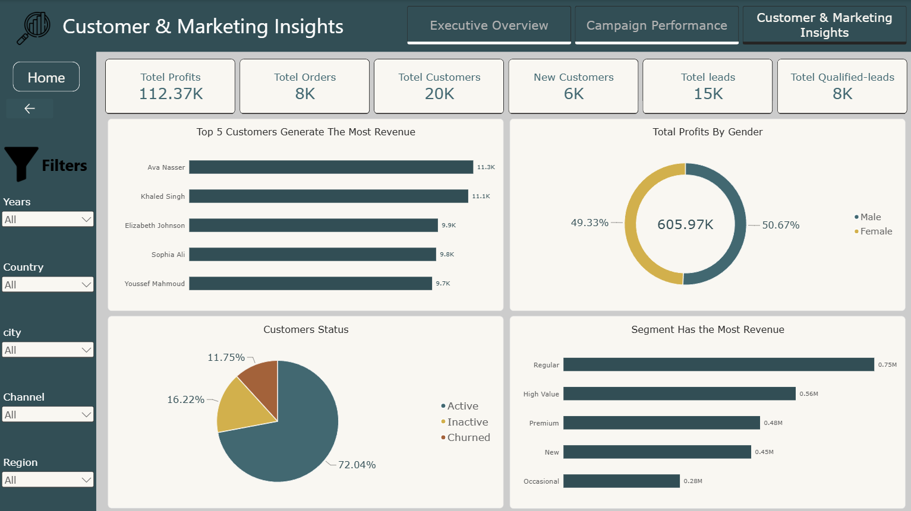

# Marketing Data Analysis | Power BI Dashboard

An interactive Power BI dashboard that analyzes marketing campaign performance, customer behavior, and revenue across channels, countries, and regions.

## About the Project

This project turns marketing and customer data into a three-page dashboard that answers questions such as:

- How profitable is the business, and how has profit changed over the years?
- Which marketing channels and campaign types give the best return on spend?
- Which regions generate the most revenue?
- Who are the most valuable customers and segments, and how many customers are still active?

## Tools Used

- Power BI Desktop
- DAX measures (ROAS, CAC, conversion rate, and other KPIs)
- Interactive slicers (Years, Country, City, Channel, Region)
- Page navigation buttons and a custom dashboard design

## Dashboard Pages

### 1. Home

A landing page with navigation buttons to the three report pages.

### 2. Executive Overview

**KPIs:** Total Revenue (2.42M), Total Cost (2.31M), Total Profits (112.37K), Total Orders (8K), Total Customers (20K), Total Spend (493.60K), ROAS (0.23)

**Visuals:**
- Total Profit Over Years
- Top 5 Channels by Profit
- Total Profit by Region
- Total Spend and Total Revenue by Year

### 3. Campaign Performance

**KPIs:** Total Revenue (2.42M), Conversion Rate (52.90%), Total Spend (493.60K), Campaign Spend (493.60K), ROAS (0.23), CAC (81.64)

**Visuals:**
- Campaign Types by ROAS
- Campaign Types by Spend
- Top 5 Campaign Types by Revenue

### 4. Customer & Marketing Insights

**KPIs:** Total Profits (112.37K), Total Orders (8K), Total Customers (20K), New Customers (6K), Total Leads (15K), Total Qualified Leads (8K)

**Visuals:**
- Top 5 Customers Generating the Most Revenue
- Total Profits by Gender
- Customers Status
- Segment with the Most Revenue

## Key Insights

### Business performance
- The business earned **2.42M** in revenue against **2.31M** in cost, leaving a profit of **112.37K** and a thin margin of about **4.6%**.
- Revenue fell every year: **1.02M** in 2024, **0.78M** in 2025, and **0.62M** in 2026.
- Profit dropped from **52K** (2024) to **21K** (2025), then recovered to **40K** in 2026 even though revenue kept falling.
- Marketing spend is **493.60K**, about **20%** of total revenue, with an overall ROAS of **0.23**.

### Channels and campaigns
- **Google Ads (49K)** and **Instagram (44K)** are the most profitable channels, followed by SMS (28K). Email and TikTok contribute 10K each.
- **Email Blast** is the best campaign type: the highest ROAS (**1.25**) and the highest revenue (**0.44M**), with only 53K spent.
- **Search** is also efficient, with a ROAS of **0.90** on the lowest spend (43K).
- **Influencer (90K)**, **Video (70K)**, and **Display (65K)** take the largest budgets, about **46%** of total spend, yet all three have **negative ROAS** (-0.10, -0.27, and -0.06).
- The conversion rate is **52.90%** and the customer acquisition cost (CAC) is **81.64**.

### Customers
- There are **20K customers**, of which **6K (about 30%)** are new.
- **72%** of customers are active, **16.2%** are inactive, and **11.8%** have churned, so about **28%** are inactive or lost.
- The **Regular** segment generates the most revenue (**0.75M**), followed by High Value (0.56M), Premium (0.48M), and New (0.45M). Occasional customers contribute the least (0.28M).
- No single customer dominates: the top 5 customers generate between **9.7K and 11.3K** each.
- About **53%** of leads (8K out of 15K) become qualified leads.
- Profit is split almost evenly between genders (about 51% male and 49% female).

### Regions
- **Africa & Middle East** is the strongest region (**1.11M**), nearly double Europe (**0.59M**). **Asia Pacific** is the weakest (**0.22M**).

## Recommendations

- Move budget from **Influencer, Video, and Display** toward **Email Blast, Search, and Social**, which have positive ROAS.
- Review or pause campaigns with negative ROAS before spending more on them.
- Launch retention campaigns (email is the strongest channel) to win back the roughly 28% of inactive and churned customers.
- Investigate the revenue decline since 2024 and look for ways to improve the thin profit margin through pricing and cost control.
- Study why Asia Pacific lags behind and whether it has room to grow.
- Improve lead qualification, since only about half of leads become qualified.
